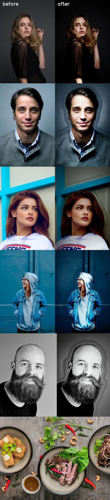

# G7X AI PHOTO

Telegram-бот, который превращает обычную фотографию в кадр со вспышкой
компактной камеры Canon G7X: свет из центра кадра, падающая яркость
в глубину, нарисованные тени, объём, плёночный цвет и зерно.



## Чем отличается от предыдущей версии

Раньше бот искал лицо (YuNet / Haar) и силуэт человека (PP-HumanSeg),
а вспышка применялась только к найденной маске. Из-за этого:

- на фото без лица или с закрытым лицом бот отказывался работать;
- фон просто затемнялся, тени и объём не рисовались;
- вокруг силуэта появлялись артефакты сегментации.

Сейчас **никаких детекторов лиц и силуэтов нет**. Вспышка всегда
считается от центра кадра, а чтобы эффект «понимал» глубину сцены,
используется карта глубины всей фотографии.

## Как работает эффект

1. **Карта глубины.** Depth Anything V2 Small (ONNX) оценивает рельеф
   всего кадра: что ближе к камере, что дальше. Карта уточняется по
   контурам самой фотографии, чтобы границы объектов не «плыли».
2. **Свет вспышки.** Вспышка стоит рядом с объективом, освещённость
   падает как `1/d²`, плюс мягкий спад к краям кадра. Ближний план
   вырывается из темноты, дальний уходит в тень — это и есть глубина.
3. **Объём.** По карте глубины считаются нормали поверхности: участки,
   развёрнутые к вспышке, светлее, уходящие в сторону — темнее.
   На разрывах глубины светотень отключается, чтобы не было тёмной
   обводки вокруг объектов.
4. **Тени.** Экранный трассировщик от точки вспышки: точка в тени,
   если луч от вспышки до неё перекрыт чем-то более близким.
   Получаются падающие тени на фоне и затенённые углубления.
5. **Цвет и плёнка.** Киношная кривая светов (ACES), тёплые света и
   холодные тени, свечение вокруг пересветов, виньетка объектива,
   зерно высокого ISO и контурное усиление резкости.

Если модель глубины недоступна (нет интернета при первом запуске или
не установлен `onnxruntime`), бот не падает: вспышка накладывается без
учёта рельефа — радиальный свет, тени и цвет остаются на месте.

## Установка

1. Python 3.10 или новее.
2. Виртуальное окружение:

   ```powershell
   python -m venv .venv
   .venv\Scripts\activate
   ```

3. Зависимости:

   ```powershell
   pip install -r requirements.txt
   ```

4. Токен бота в `.env`:

   ```
   BOT_TOKEN=1234567890:AA...
   ```

5. Запуск:

   ```powershell
   python bot.py
   ```

При первом запуске бот один раз скачает модель глубины (~95 МБ) в папку
`models/`. Дальше она загружается с диска за секунду.

## Проверка без Telegram

Можно прогнать любую фотографию локально:

```powershell
python tools/preview.py photo.jpg --compare --depth
```

Получится `photo_g7x.jpg`, картинка «до / после» и карта глубины.

## Настройка эффекта

Всё собрано в двух датаклассах с понятными именами:

- `processing/relight.py` — `FlashSettings`: положение вспышки
  (`light_x`, `light_y`), спад света (`falloff`, `beam`), яркость
  рассеянного света (`ambient`), сила теней (`shadow_*`) и объёма
  (`relief`, `fill`), блики, затемнение углублений.
- `processing/grade.py` — `GradeSettings`: экспозиция, контраст,
  насыщенность, тонирование, свечение, виньетка, зерно, резкость.

Например, чтобы фон был чернее, уменьшите `FlashSettings.ambient`.
Чтобы тени были жёстче — увеличьте `shadow_strength` и уменьшите
`shadow_softness`.

## Скорость

Одно фото на обычном ноутбуке — примерно 2–5 секунд (зависит от
разрешения и загрузки CPU). Тяжёлая часть считается в отдельном потоке,
одновременно обрабатывается несколько фотографий.

## Что важно знать про тени

Тени считаются физически: точка в тени, если луч от вспышки до неё
перекрыт чем-то более близким. Поэтому на однотонном фоне рядом с
объектом появляется заметная мягкая тень и светлое «пятно» вокруг
силуэта — так и снимает встроенная вспышка. Если такой эффект не нужен,
уменьшите `FlashSettings.shadow_strength` и `falloff`.

## Структура

```
bot.py                 запуск и роутеры
config.py              токен, папки, лимиты
handlers/
  start.py             /start, /help, подсказка на текст
  photo.py             приём фото, обработка, отправка результата
processing/
  depth.py             карта глубины (ONNX) + резервный режим
  relight.py           свет вспышки, тени, объём, блики
  grade.py             тон-маппинг, цвет, зерно, виньетка
  imaging.py           базовые операции над изображением
  pipeline.py          сборка всего эффекта
tools/preview.py       локальный просмотр результата
models/                сюда скачивается модель глубины
```

## Требования

- `aiogram` — Telegram Bot API
- `opencv-python`, `numpy` — обработка изображения
- `onnxruntime` — вывод модели глубины
- `python-dotenv` — чтение `.env`
